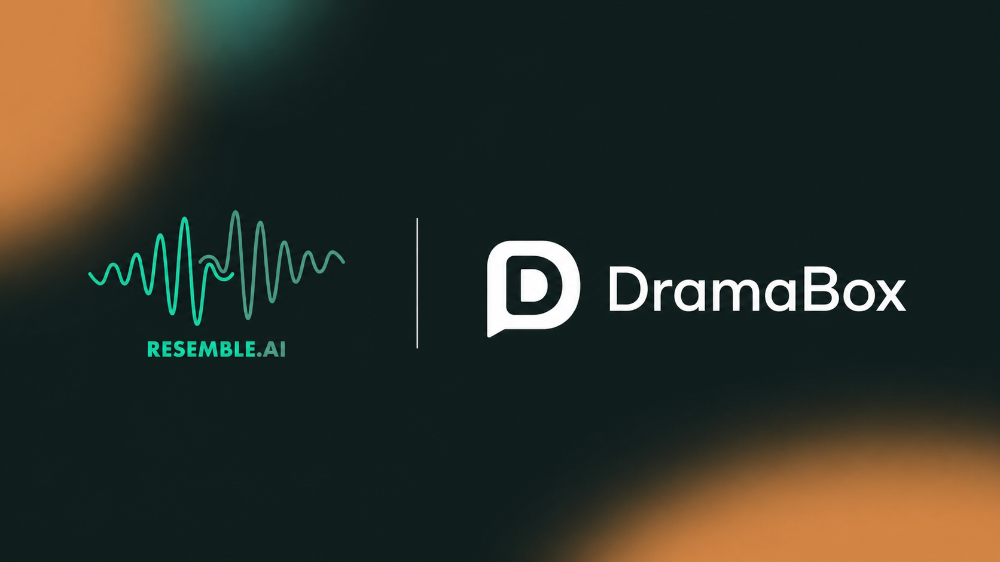

<p align="center">
  
</p>

# DramaBox Studio — AI Voice Studio (Community Edition)

[](LICENSE)
[](https://github.com/Lightricks/LTX-2)
[](https://github.com/resemble-ai/DramaBox)

A community distribution of **Resemble AI's DramaBox** — expressive, prompt-driven TTS with voice cloning. The prompt controls speaker identity, emotion, delivery, laughs, sighs, pauses and transitions; a 10-second voice reference clones the target timbre.

**Built for Chinese users. Optimized for low-VRAM GPUs. Batteries included.**

---

## What's Different from Upstream

| Feature | Upstream | DramaBox Studio |
|---|---|---|
| VRAM peak | ~24 GB | **~8 GB** (8 GB cards supported) |
| VRAM config | Manual | **Auto-detect** (3 CUDA tiers + 2 Apple Silicon tiers) |
| Apple Silicon | No | **MLX Gemma + MPS** (16 GB / 24 GB+ Macs) |
| UI | Default Gradio | **Midnight Gold** dark cinematic theme |
| Voice library | None | **Upload / name / list / delete** |
| Dialogue workshop | None | **Script → auto-parse characters → batch generate** |
| Prompt examples | 2 English | **8 Chinese-scene examples** with English direction |
| Prompt helpers | None | **One-click speaker tags + 18 non-verbal cues + quote wrapper** |
| Language | English prompts | English direction + Chinese dialogue supported |

---

## Demo

<video src="https://github.com/user-attachments/assets/29385327-8af3-4ef0-a8d5-3c57a8225409" controls width="100%"></video>

---

## Quick Start

### Prerequisites

- Windows 10 / 11 or Linux, NVIDIA GPU with **8 GB+ VRAM**, NVIDIA driver installed, 32 GB RAM recommended for 8–16 GB cards (idle models wait in host RAM)
- or macOS 14+ on Apple Silicon with **16 GB+ unified memory** (see [Apple Silicon](#apple-silicon-mlx))

### Option 1: Integration Package (Recommended)

Download the all-in-one package (embedded Python + models included):

> [Download — 一键包下载.vip](https://wangzhifeng.vip/)
> 
> Win系统一键启动整合包，解压即用。含嵌入式 Python 环境 + 全部模型权重。

Unzip, double-click `DramaBoxStudio.bat`, open `http://localhost:7860`.

### Option 2: Run from Source

**Requirements**

- Python 3.10 – 3.13
- Git
- ~25 GB free disk space (for model weights)
- Internet connection (first run only — downloads model weights)

**Step 1: Clone**

```bash
git clone https://github.com/wwzhifeng/DramaBoxStudio.git
cd DramaBoxStudio
```

**Step 2: Install PyTorch with CUDA**

```bash
pip install torch==2.8.0 torchaudio==2.8.0 --index-url https://download.pytorch.org/whl/cu128
```

Pick the CUDA version matching your driver. Check with `nvidia-smi` (top-right corner).

| NVIDIA driver | CUDA version | pip index |
|---|---|---|
| >= 572.00 | CUDA 12.8 | `cu128` |
| >= 550.00 | CUDA 12.4 | `cu124` |
| >= 545.00 | CUDA 12.1 | `cu121` |

**Step 3: Install remaining dependencies**

```bash
pip install -r requirements.txt
```

**Step 4: Launch**

```bash
python app.py
```

Open `http://localhost:7860` in your browser.

### Model Download

**Option 1 users (Integration Package):** models are included — skip this section.

**Option 2 users (Run from Source):** download the following models and place them under `models/`:

| Model | Source | Where to put it |
|---|---|---|
| DiT Transformer (`dramabox-dit-v1.safetensors`) | [ResembleAI/Dramabox](https://huggingface.co/ResembleAI/Dramabox) | `models/checkpoints/` |
| Audio Components (`dramabox-audio-components.safetensors`) | [ResembleAI/Dramabox](https://huggingface.co/ResembleAI/Dramabox) | `models/checkpoints/` |
| Text Encoder (Gemma 3 12B, 4-bit) | [unsloth/gemma-3-12b-it-bnb-4bit](https://huggingface.co/unsloth/gemma-3-12b-it-bnb-4bit) | `models/gemma/` |

**Total: ~16 GB.**

If HuggingFace is slow in your region, use a mirror:
```bash
set HF_ENDPOINT=https://hf-mirror.com
```
Then download the files manually or with `huggingface-cli download`.

---

## Performance vs the Previous Version

Not benchmarked against the previous version of this repo; the gains below follow from what changed. Numbers marked *measured* are from this version on an RTX 3070 Ti Laptop (8 GB), 30 steps, a 10 s voice reference and ~9.6 s of audio per line.

| Change | Before | Now | Expected gain |
|---|---|---|---|
| 8 GB cards | Low-VRAM path called `.to()` on a DiT that wasn't built yet — crashed at startup | Konvey's staged pipeline | Runs at all: *measured* 18 s per 9.6 s line, 6.87 GB GPU peak |
| Negative prompt | Re-encoded by Gemma 12B on every generation | Encoded once, cached on disk | One Gemma pass saved per generation |
| Repeated prompts (re-rolls, new seeds) | Gemma ran every time | Cached in memory and on disk | Gemma skipped entirely; on 8 / 16 GB no stage swap either |
| Gemma on 8 / 16 GB | Moved CPU ↔ GPU from pageable memory every generation | Parked in page-locked RAM, only for new prompts | Swaps of ~0.5 s (*measured*), and only when a prompt is new |
| Gemma tokens | All 1024 padded tokens through Gemma 12B | Real tokens only (`DRAMABOX_TRIM_PADDING`) | ~5–10× less Gemma work for typical prompts; *measured* 3 new prompts in 1.9 s vs 4.8 s padded, swaps included |
| DiT on 8 / 16 GB | torchao INT8 weight-only (dequantized every matmul) | bf16 | No per-matmul dequantization; full-precision weights |
| Dialogue workshop | Gemma swapped in and out for every line | Every line encoded in one batch first | One swap per script instead of one per line |
| Voice reference | VAE-encoded on every generation | Encoded once per voice | One VAE encode saved per generation |
| Embeddings processor | ~1.44 GB extra GPU per prompt | `project-exact`: 0.54 GB, `project`: 0.08 GB (*measured*) | More headroom while encoding |

## VRAM Tiers

Picked automatically at startup; override with `DRAMABOX_TIER=low|balanced|performance|mlx-16|mlx-24`.

| Tier | Hardware | How it runs |
|---|---|---|
| `low` | CUDA < 11 GB | Gemma (embedding table looked up on the CPU, ~5.8 GB), the embeddings processor and the audio stage (DiT bf16 + VAE + vocoder, ~7 GB) take turns on the GPU; idle ones wait in pinned host RAM (back in ~0.5 s) |
| `balanced` | CUDA 11–20 GB | Text stage (Gemma + embeddings processor) and audio stage take turns on the GPU |
| `performance` | CUDA ≥ 20 GB | Everything resident on the GPU |
| `mlx-16` | Mac < 24 GB | Gemma in MLX, loaded only to encode new prompts; DiT on MPS |
| `mlx-24` | Mac ≥ 24 GB | Gemma in MLX resident; DiT on MPS |

All compute runs on the GPU in every tier. Prompt embeddings are cached in memory and on disk (`cache/prompt-embeds/`): the negative prompt and any prompt seen before skip Gemma entirely, and the dialogue workshop encodes every line up front so the low-VRAM tiers swap stages once per script.

**Padding trim** (`DRAMABOX_TRIM_PADDING`, default `1`): Gemma runs on the prompt's real tokens only and the hidden states are zero-padded to 1024 afterwards, instead of running all 1024 padded tokens. The padded positions are masked out and replaced by the connector's learned registers, so the result should match; set `DRAMABOX_TRIM_PADDING=0` for the original padded path. Apple Silicon always trims.

**Host RAM on `low` / `balanced`** (`DRAMABOX_PARK`): where a stage waits while another uses the GPU. Swaps only happen when there are new prompts to encode.

| `DRAMABOX_PARK` | In host RAM | Swap cost |
|---|---|---|
| `both` (default) | Every stage, all the time (~17 GB on 8 GB cards) | ~0.5 s |
| `ssd` | One big model at a time (~9–10 GB incl. the 2 GB embedding table) | ~0.5 s when the background SSD read finished in time, else the rest of a ~6–7 GB read; ~14 GB of SSD in `cache/park/` |

With `ssd`, Gemma is built on the GPU at startup while the audio stage is built on the CPU straight into RAM. Every stage's weights are written once to `cache/park/`, so a stage leaving the GPU is simply freed, and the next stage is read from the SSD into RAM in the background while the GPU works.

**Gemma output** (`DRAMABOX_GEMMA_OUTPUT`, every tier): on 8 GB cards Gemma's output waits in host RAM while the embeddings processor takes Gemma's place on the GPU; the table below is for that tier. On the other tiers Gemma and the processor share the GPU, so nothing is stored (`real` behaves like `full`), and `project` / `project-exact` lower the GPU peak while encoding.

| `DRAMABOX_GEMMA_OUTPUT` | Stored per prompt | Gemma-stage GPU peak | vs Konvey (trim off) |
|---|---|---|---|
| `full` | 0.37 GB (trim off) | 6.31 GB | identical |
| `real` (default) | ~0.37 MB per real token | 5.75 GB (trim on) / 6.31 GB (trim off) | identical |
| `project` | ~4 KB per real token | 6.50 GB | ~0.5–1.4% rounding differences |
| `project-exact` | ~4 KB per real token | 7.0 GB (7.47 GB reserved, trim off) | identical; falls back to `project` per prompt if the GPU runs out |

`real` is the default because it leaves the most room on desktop cards that also drive monitors; `project-exact` fits a headless 8 GB card.

On the other tiers, measured as the extra GPU memory the embeddings processor needs per prompt: `full` / `real` 1.44 GB, `project-exact` 0.54 GB (identical output), `project` 0.08 GB (~0.5–1.4% rounding differences).

`DRAMABOX_INT8=1` quantizes the DiT with torchao on the `performance` tier (off by default).

**Example:**

```bash
# 8 GB card with 16 GB of RAM: one big model in RAM at a time
DRAMABOX_PARK=ssd python app.py

# headless 8 GB card, exact embeddings with the least RAM
DRAMABOX_TRIM_PADDING=0 DRAMABOX_GEMMA_OUTPUT=project-exact python app.py
```

| Variable | Values | Default |
|---|---|---|
| `DRAMABOX_TIER` | `low`, `balanced`, `performance`, `mlx-16`, `mlx-24` | auto |
| `DRAMABOX_PARK` | `both`, `ssd` | `both` |
| `DRAMABOX_GEMMA_OUTPUT` | `full`, `real`, `project`, `project-exact` | `real` |
| `DRAMABOX_TRIM_PADDING` | `1`, `0` | `1` |
| `DRAMABOX_INT8` | `1` | off |
| `DRAMABOX_MLX_GEMMA` | path to an MLX Gemma folder | `models/gemma-mlx` |

---

## Apple Silicon (MLX)

Gemma 3 12B 4-bit runs in MLX (`mlx-community/gemma-3-12b-it-4bit`, ~8 GB); the rest of DramaBox runs in PyTorch on MPS.

```bash
pip install -r requirements-mac.txt
huggingface-cli download mlx-community/gemma-3-12b-it-4bit --local-dir models/gemma-mlx
python app.py
```

The DiT and audio components go in `models/checkpoints/` as above; `models/gemma/` (bnb 4-bit) is not needed on a Mac. `DRAMABOX_MLX_GEMMA` points at another MLX Gemma folder.

---

## Prompt Writing

```
<speaker description in English>, "<dialogue>" <action direction> "<more dialogue>"
```

**Inside quotes** — spoken aloud:
- Dialogue: `"Hello, how are you?"`
- Vocal sounds (one word): `"Hahaha"` `"Hehehe"` `"Mmmmm"` `"Ugh"`

**Outside quotes** — performed, not spoken:
- `She sighs deeply.` · `A long pause.` · `He clears his throat.`
- `Her voice cracks.` · `He gulps nervously.` · `She drops to a whisper.`

**Never put inside quotes:** `Sigh` `Gasp` `Cough` `Ahem` `Pfft` — the model will speak them literally.

**Tips:**
- Match speaker description gender/age to the voice reference
- Break long dialogue with stage directions between segments
- Use the built-in cue dropdown (18 non-verbal actions) to insert at cursor
- Select Chinese text and click `「」→""` to wrap it in quotes

---

## Inference Settings

| Parameter | Default | Effect |
|---|---|---|
| `cfg_scale` | 2.5 | Lower = more natural, higher = more text-faithful |
| `stg_scale` | 1.5 | Skip-token guidance for expressiveness |
| `duration_multiplier` | 1.1 | 10% breathing room on auto-estimated length |
| `steps` | 30 | Euler flow matching |
| Speed | 0.5–2.0x | Tempo change without pitch shift |

---

## Roadmap

- [ ] Structured prompt builder (visual fill-in-the-blank UI)
- [ ] Streaming audio playback
- [ ] Batch export with subtitle (.srt) generation
- [ ] More Chinese reference voices
- [ ] Chinese LoRA fine-tune for native-level Mandarin prosody

---

## Contributing

Contributions are welcome! This is a community project — if you have ideas, bug fixes, or want to add features:

- **Bug report / Feature request:** [Open an Issue](../../issues)
- **Code contribution:** Fork the repo, create a branch, [open a Pull Request](../../pulls)
- **Share your prompts:** Found a great prompt recipe? Share it in Discussions
- **Chinese voices:** Have a clean 10s+ Chinese voice sample? Contributions to the voice library are especially welcome

If you're not sure where to start, check the [Roadmap](#roadmap) above or look for issues tagged `good first issue`.

---

## License

This project is a derivative of [ResembleAI/DramaBox](https://github.com/resemble-ai/DramaBox), which is an IC-LoRA fine-tune of [Lightricks/LTX-2.3](https://github.com/Lightricks/LTX-2). Distributed under the **LTX-2 Community License Agreement** — see [LICENSE](LICENSE).

**Attribution:**
- Original DramaBox by [Resemble AI](https://www.resemble.ai/learn/models/dramabox)
- Base model LTX-2.3 by [Lightricks](https://github.com/Lightricks/LTX-2)
- Community modifications by **Wang Zhifeng** ([wangzhifeng.vip](https://wangzhifeng.vip/))
- VRAM tiers, Apple Silicon (MLX) support and the low-VRAM pipeline by **Siddid Soni** (October 2026), ported from Konvey

Model weights are auto-downloaded from [ResembleAI/Dramabox](https://huggingface.co/ResembleAI/Dramabox) on HuggingFace and are **not** included in this repository.

---

## Disclaimer

This is an unofficial community distribution. For the official DramaBox, visit [ResembleAI/DramaBox](https://github.com/resemble-ai/DramaBox).

DramaBox outputs are automatically watermarked with [Resemble Perth](https://github.com/resemble-ai/Perth) when the watermark feature is enabled. Please comply with the [LTX-2 Acceptable Use Policy](LICENSE) when using generated audio.
